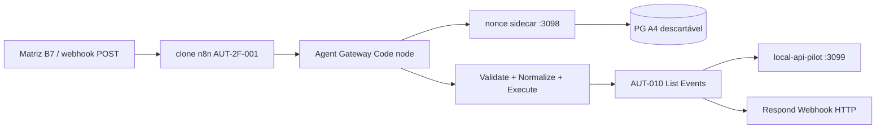

# SENTINELAAUT — D-P0-2B-4B-B7 — Integração real Gateway agent-v1 + n8n + API piloto

**Data:** 2026-11-05
**Referências:** B4, B5, B6 (`docs/evidence/results/SENTINELAAUT-D-P0-2B-4B-B*.md`)
**Escopo:** ambiente isolado `sentinelaaut-n8n-dp02b3-isolated` — **sem** n8n live / Supabase LIVE.

---

## 1. Fase 0 — Pré-check

| Item | Resultado |
|------|-----------|
| SHA Git (working tree, sem commit B7) | `f0d76ccbe6ebe1e6925a34b91e50fc6c0491fd68` |
| Relatórios B4–B6 | Lidos / presentes |
| Gateway agent-v1 (código) | `scripts/n8n-harness/agentGatewayValidate.n8n.js`, `api/v1/_lib/agentGateway/*`, handler `nonce-consume` |
| API piloto | `scripts/n8n-harness/local-api-pilot.ts`, launcher `run-local-api-pilot.mjs`, `pilot.vite.config.ts` |
| n8n live | **Up** — não utilizado |
| Clone / volumes / rede | `sentinelaaut-n8n-dp02b3-import`, volumes A3/A4 preservados, rede **Internal: true** |
| Stub B6 | **Não** utilizado como prova B7 |

---

## 2. Fase 1 — Causa do bloqueio B6 e solução

| Problema | Causa | Mitigação B7 |
|----------|-------|----------------|
| Rollup / vite-node no container | Montagem de `node_modules` **Windows** em Linux → `@rollup/rollup-linux-*` ausente | **`npm ci` dentro** de `Dockerfile.api-pilot` (Linux) |
| Módulos em falta no COPY | `sentinela/core`, `utils/*` importados por handlers | COPY explícito no Dockerfile |
| Rede internal | `host.docker.internal` inacessível | Serviço `sentinelaaut-api-pilot-dp02b3:3099` na rede isolada |
| Bind `0.0.0.0` | Gate `pilotIsolationGate` exigia loopback em **env** e **host** | `SENTINELA_PILOT_ISOLATED_DOCKER=1` + `isAllowedPilotBindHost()` |

**Imagem:** `sentinelaaut-api-pilot-dp02b3:local` (build local, digest registado no engine Docker).

**Health (evidência):** `GET http://sentinelaaut-api-pilot-dp02b3:3099/api/v1/health` → **200**, corpo `local-api-pilot` (G7-H-B, stores em memória).

---

## 3. Arquitetura executada

| Container | Função |
|-----------|--------|
| `sentinelaaut-api-pilot-dp02b3` | **API piloto real** (`local-api-pilot.ts`) |
| `sentinelaaut-n8n-dp02b3-import` | AUT-2F-001 + filhos publicados |
| `sentinelaaut-agent-nonce-sidecar-dp02b3` | Nonce consume → PG |
| `sentinelaaut-pg-nonce-test-a4` | Postgres descartável |
| `sentinelaaut-n8n-local` | **Inalterado** |

Clone env (gitignored `n8n-clone-b4.env`): gateway B4/B5 + credenciais piloto + `SENTINELA_API_BASE_URL=http://sentinelaaut-api-pilot-dp02b3:3099` (`merge-clone-b7-env.mjs`).

---

## 4. Fase 2 — Matriz agent-v1 + n8n + API real

Script: `scripts/n8n-harness/dp04-b7-real-gateway-matrix.mjs`
Evidência: `backups/d-p0-2b-4b-b6-20261105/b7-matrix.json`

| # | Cenário | HTTP | Filho / efeito |
|---|---------|------|----------------|
| 1 | HMAC agent válido → LIST_EVENTS | **200** | `dispatched_aut: AUT-010`, `ok: true` — **API piloto real** |
| 2 | HMAC inválido | **401** | Sem filho |
| 3 | Key ID desconhecida | **401** | Sem filho |
| 4 | Timestamp expirado | **401** | Sem filho |
| 5 | Nonce repetido | **200 → 401** | 2.ª chamada bloqueada |
| 6 | Concorrência consume (8×) | **1×200, 7×409** | Sidecar + PG |
| 7 | Tenant no body (override) | **200** | Strip + tenant env (AUT-010) |
| 8 | PostgreSQL parado | **503** | Webhook (nonce store indisponível) |
| 9 | PG recuperado | **200** | (revalidado pós-restart sidecar) |

**Não exercido nesta sessão:**

- Identidade **API** 403 (cliente `n8n-pilot-readonly`) — exigiria env dedicado no clone.
- Tenant **API** mismatch com headers HMAC errados — tenant vem do vault env no filho; mismatch de org/condo no HMAC v1 seria rejeitado na API (contrato), não simulado aqui além do strip de body.

Respostas de erro: códigos públicos (`AGENT_AUTH_FAILED`, etc.); sem secrets nos corpos amostrados.

---

## 5. Fase 3 — Inventário workflows (AUT-2F-001)

Entrada webhook: `POST /webhook/sentinelaaut/aut-2f-001` (gateway agent-v1).

Filhos mapeados no router (allowlist — **execução B7 apenas LIST_EVENTS / AUT-010**):

| Intent (ex.) | Filho | Mecanismo | API v1 (filho) |
|--------------|-------|-----------|----------------|
| LIST_EVENTS | AUT-010 | Execute Workflow | GET `/api/v1/events` |
| LIST_PACKAGES | AUT-3B-001 | Execute Workflow | packages list |
| LIST_OCCURRENCES | AUT-3B-002 | … | occurrences |
| … | AUT-001…009, 2A–2D, 2F-002, 3B-003…005 | … | Ver specs em `n8n/workflows/AUT-*.json` |

Contrato comum filhos Fase 1: Validate → Generate HMAC (`$env` tenant) → HTTP Request → envelope final. **NOT VERIFIED** operacionalmente na B7 excepto AUT-010.

---

## 6. Fase 4 — Evidência funcional LIST_EVENTS

- Autenticação **agent-v1** no nó Gateway (não stub).
- Nonce persistido via sidecar **PostgreSQL** (A4).
- Filho **AUT-010** executado (`dispatched_aut` no envelope).
- HTTP **200** com `httpStatus: 200` no `result` — resposta via **Respond Webhook** (B5).
- API downstream: **`local-api-pilot.ts`** (handler `createEventsHandler`, permission `events.view`).

Auditoria Event Store produção: piloto usa memória — eventos listados são **sintéticos do pilot**, não Supabase LIVE.

---

## 7. Fase 5 — Regressão

| Suíte | Resultado |
|-------|-----------|
| B5 Vitest (19 ficheiros) | **177/177 PASS** |
| `pilotIsolationGate.test.ts` (+ bind isolado) | **PASS** |
| A5 PostgreSQL | **11/11 PASS** |
| Matriz B4 | Auth **401**; `webhook_valid_list_events` **200** com piloto real |
| Matriz B6 | **Não reexecutada** como prova (stub); B7 substitui |

---

## 8. Ficheiros alterados (working tree, sem commit)

| Ficheiro | Alteração |
|----------|-----------|
| `docker/dp02b3-isolated/Dockerfile.api-pilot` | Novo — build Linux + piloto real |
| `docker/dp02b3-isolated/compose-b7-real-pilot.yml` | Novo — orquestração (sidecar via extends) |
| `scripts/n8n-harness/pilotIsolationGate.ts` | Bind isolado Docker |
| `scripts/n8n-harness/local-api-pilot.ts` | Pass `process.env` ao gate |
| `scripts/n8n-harness/pilotIsolationGate.test.ts` | Teste bind isolado |
| `scripts/n8n-harness/merge-clone-b7-env.mjs` | URL piloto DNS interno |
| `scripts/n8n-harness/dp04-b7-real-gateway-matrix.mjs` | Matriz B7 |

---

## 9. Limitações remanescentes

1. API piloto = **memória** (G7-H-B), não Vercel prod nem Supabase LIVE.
2. Apenas **LIST_EVENTS** comprovado ponta-a-ponta na B7.
3. `compose-b7-real-pilot.yml` requer rede/volumes externos (mesmo padrão B4).
4. Host Windows: piloto local `:3099` pode colidir (EADDRINUSE) — irrelevante quando piloto corre **só** no container B7.

---

## 10. Live / Supabase

| Sistema | Estado |
|---------|--------|
| n8n live | **Up**, não importado |
| Supabase LIVE | **Não acedido** |

---

## 11. Rollback

1. Parar `sentinelaaut-api-pilot-dp02b3`, clone, sidecar (feito ao encerrar B7).
2. Reverter env clone para stub/127.0.0.1 via backup ou `merge-clone-b6-env.mjs`.
3. Remover imagem local `sentinelaaut-api-pilot-dp02b3:local` se desejado (opcional).

---

## 12. Veredito

**PASS WITH CONDITIONS**

| Critério | Estado |
|----------|--------|
| Eliminar dependência do stub B6 como prova | **PASS** |
| `local-api-pilot.ts` real no Docker Linux | **PASS** |
| Gateway agent-v1 + nonce PG + n8n + AUT-010 + API | **PASS** |
| Matriz prioritária Fase 2 (itens executados) | **PASS** |
| Demais workflows AUT-2F-001 | **NOT VERIFIED** |
| Identidade API 403 dedicada | **NOT VERIFIED** |

Integração **real** agent-v1 → n8n → filho → **API piloto G7-H-B** comprovada para **LIST_EVENTS**. Condições: cobertura parcial de workflows e identidade API readonly.

**Aguardando autorização para B8** (sem versionamento/deploy nesta fase).
